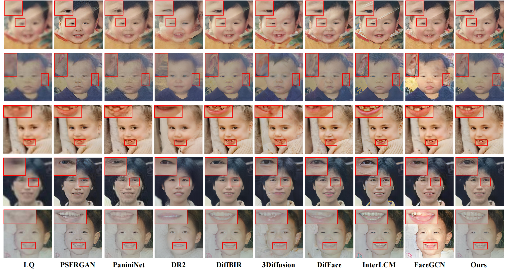
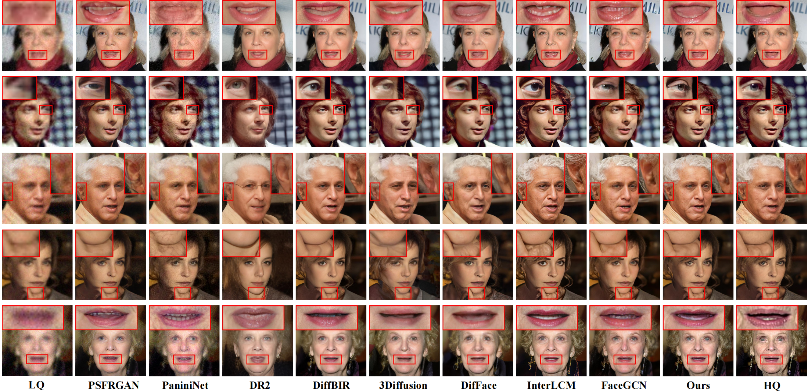

# Degradation-aware Generative Network with Controllable Texture Prompt for Blind Face Restoration

## :book: Installation
1. Clone repo
    ```bash
    git clone https://github.com/hgpftd/DCTP
    cd DCTP
    ```

1. Install dependent packages

    ```bash
    pip install -r requirements.txt
    pip install -e .
    ```

## :book: Datasets
**Datasets for Training**
We use [FFHQ](https://github.com/NVlabs/ffhq-dataset) for training. All of them are resized to 512x512.

**Datasets for Testing**
We use LFW-Test, and WebPhoto-Test as the real-world datasets. The download links can refer to [DAEFR](https://github.com/LIAGM/DAEFR) and [VQFR](https://github.com/TencentARC/VQFR).

## Train
Please modify `options/DCTP.yml` according to your needs.
```bash
sh train.sh 
```

## Inference

Please adjust the model weight path, input path, and output path as needed.

```bash
python inference.py --model_path weights/net_g.pth --input data/LQ --output results/restored 
```


## :sparkles: Visual Results
<p align="center">
  
</p>
<p align="center">
  
</p>


## Acknowledgement

This project is based on [GCFSR](https://github.com/hejingwenhejingwen/GCFSR) and [BasicSR](https://github.com/XPixelGroup/BasicSR). Thanks for their awesome work.

